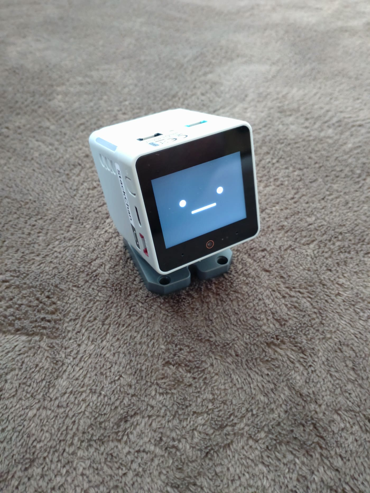

# stackchan-lab

M5 スタックちゃん（**M5STACK-K151** / M5Stack CoreS3）の開発記録と作業用ツール。

セットアップで実際に踏んだ問題、その原因の突き止め方、再現できる手順を残しています。

**解説記事**: [日本語 (Qiita)](https://qiita.com/yasumorishima/items/ef4951ed8483fd8f34dd) / [English (DEV.to)](https://dev.to/yasumorishima/m5-stackchan-pairing-fails-with-no-devices-found-the-factory-firmware-is-the-cause-387e)

## 実物

**応援歌を歌っているところ**

https://github.com/user-attachments/assets/c8362b72-3d51-4fe3-9bae-85891034855b

（17 秒・音あり。ファイル本体は [docs/media/kyoda-cheer-song.mp4](docs/media/kyoda-cheer-song.mp4)、音なしの [GIF](docs/media/kyoda-cheer-song.gif) もあります）

「京田陽太さんの応援歌を歌いますね」と言ってから、ゲームの譜面から起こした旋律で歌います（歌詞は公式のもの、掛け声は歌いません）。

> 歌えるのは 16 曲ですが、**人が聴いて確かめたのはこの京田だけ**です。ほかの曲は合成した音を機械で測った（声の割合・渡した楽譜とのずれ・最長の無音）だけで、耳では確かめていません。**この数値は「合成器が楽譜どおり鳴らしたか」であって、応援歌として良いかではありません**。残りは今後聴いて直すかもしれませんし、直さないかもしれません。

> **時期についての注記**: 本体を入手したのは **2026-07-24**（スイッチサイエンス）、最初のセットアップは **2026-07-25** です。この時点の**出荷時ファームウェアは 1.2.4**（2026-04-20 公開）、**公式最新は 1.4.4**（2026-07-13 公開）でした。本製品は 2026-05 発売の新製品で、ファームウェアもアプリも更新が続いています。**入手時期によって出荷時のファーム版数は変わる**ため、下記の症状に当たるかどうかも時期によって変わります。

## いまできること

| | |
|---|---|
| 会話 | 声で聞いて、声で返します。本体の接続先を[自前サーバー](server/)へ向けているので、中国のクラウドは経由しません |
| 認識 | sherpa-onnx + ReazonSpeech k2 v2（Raspberry Pi 5 上のローカル処理）。**声とみなす敷居は 2 本**で、話し始めたあとは下げます（1 本だと語の中の谷を無音と数えて語の頭だけで切ってしまい、「あ」「あれ」しか認識されません） |
| 応答 | さくらのAI Engine `gpt-oss-120b`（月 3,000 リクエストまで無償） |
| 読み上げ | Open JTalk（ローカル）。長い呼気段落は分けて合成し、読みが遅ければ実測して分け直します。**本体の小さいスピーカーで歌と同じ大きさに聞こえるよう、鳴らない低音を落としてから音量を合わせます** |
| 応答の速さ | **返答は書き終わるのを待たず、1 文できた時点で読み上げ始めます**。聞き取りに渡すのも「いま終わった発話 1 回ぶん」だけ |
| 道具 | サーバー側 19 個（天気・週間天気・為替・株価指数・暗号資産・ニュース・地震・警報・台風・熱中症・電車・今日は何の日・月齢・燃油サーチャージ・渡航情報・プロ野球の速報と順位・出場選手の登録抹消・選手応援歌の歌詞・**応援歌を旋律つきで歌う**）＋ 本体側 11 個（画面・サーボ・カメラなど） |
| 歌える曲 | **16 曲**（譜面から 12・音源から 4）。**ゲームの応援歌エディタの譜面**をピアノロール動画から読み取って旋律にしています。読み取りが正しいかは**別の動画をもう一度読み取って一致するか**で確かめます。歌詞は公式のものを実行時に取得し、**掛け声（「オオオオー」や「かっとばせー！」）は歌いません**。助詞の「は」「へ」は歌うとき「わ」「え」に読み替えます（どこが助詞かは形態素解析に訊きます） |
| 呼びかけ | 本体のファームは、**「Hi, StackChan」と聞こえるまで音声をサーバーへ送りません**（`CONFIG_SR_WN_WN9_HISTACKCHAN_TTS3`）。**画面の顔をタップしても会話が始まります** |
| 割り込み | 読み上げの途中で話しかけると、残りをやめて聞き直します |

どう作ったか、何を測って決めたかは **[docs/progress.md](docs/progress.md)** に日付順で残しています。

## ドキュメント

索引は [docs/README.md](docs/README.md) にあります。

| ページ | 内容 |
|---|---|
| [初期設定とペアリング不能問題](docs/setup/pairing-and-firmware.md) | アプリで `No devices found` が出て設定が終わらない問題。シリアルログでの切り分けから、原因（出荷時ファームが古い）と解決までの全記録。踏んだ罠の一覧つき |
| [公式ファームウェアを USB で書き込む](docs/setup/firmware-flash.md) | M5Burner（GUI）を使わず、公開 API と `esptool` 単体実行ファイルで公式バイナリを書き込む手順。ロールバック方法も記載 |
| [音声バックエンド差し替えの検討](docs/voice/voice-backend-plan.md) | 出荷時は中国のクラウド XiaoZhi 経由。自前サーバーへ寄せる設計と、無償枠・自前ビルド・プロビジョニングの前提整理。差し替えポイントと現在の進捗 |
| [XiaoZhi WebSocket プロトコル](docs/voice/xiaozhi-websocket-protocol.md) | 自前サーバーを書くために必要な仕様のまとめ。OTA 応答スキーマ、hello の交換、音声フレームの形式、JSON メッセージの一覧 |
| [自前サーバーの実装](server/) | 本体の接続先をこのサーバーへ向けるための実装一式。OTA と WebSocket、ローカル音声認識、VOICEVOX での読み上げ、MCP のツール呼び出し。実機なしで検証するための試験クライアントとモックつき |
| [クラウドから本番（RPi5）へ出す](docs/pi-deploy.md) | Pi が 2 分ごとに `main` を見て、変わったファイルを 8003 番の写しで試験してから本番へ入れ替える仕組み。結果は非公開の `stackchan-logs` の `deploy/LATEST.md`。Pi で何かを走らせる依頼（`ops/requests/`）の書き方つき |

## 要点だけ先に

初期設定でアプリが `No devices found` を返す場合、**Bluetooth の権限ではなく出荷時ファームウェアが古いことが原因**の可能性があります。シリアルログを見ると BLE 接続とハンドシェイクは成功していて、アプリ側が応答の検証段階で止まっていました。

さらに **新ファームは OTA → OTA には Wi-Fi → Wi-Fi 設定にはアプリのペアリング** という循環になっており、**USB 書き込み以外に出口がありません**。詳細は [初期設定とペアリング不能問題](docs/setup/pairing-and-firmware.md) を参照してください。

## さくらのAI Engine について実測で分かったこと

会話の頭脳に **[さくらのAI Engine](https://ai.sakura.ad.jp/sakura-ai/ai-engine/)** の `gpt-oss-120b` を使っています。使う前に迷いやすい点を、実際に API を叩いて確かめた結果として残します（2026-08-09 時点）。

**「OpenAI・Anthropic 互換」の Anthropic 互換は、API の形式が互換という意味です。Claude が使えるわけではありません。**

- `POST /v1/messages`（Anthropic 形式）は**実際に動きます**。返る形も Anthropic のもので、`content` ブロック・`stop_reason`・`usage.input_tokens` が揃っています。ただし**応答するのは `gpt-oss-120b`** です
- Claude を指定すると拒否されます。`claude-sonnet-4-20250514` も `claude-3-5-sonnet-20241022` も `{"error":{"message":"This model is not available."}}` でした
- `GET /v1/models` で配布モデルを一覧すると **12 個すべて `owned_by: "sakura"` の公開ウェイトモデル**（`gpt-oss-120b` / `llm-jp-3.1-8x13b-instruct4` / `Kimi-K2.6` / `Qwen3.6-35B-A3B` / `gemma-4-31B-it` / `Phi-4-mini` / `whisper-large-v3-turbo` / `multilingual-e5-large` ほか）で、Anthropic のモデルは含まれません

つまり **OpenAI 互換と Anthropic 互換のどちらを選んでも、動くモデルは同じ**です。違うのはリクエストとレスポンスの形だけなので、既存コードが喋る方言に合わせて選べば十分です。このサーバーは Ollama から移してきた経緯があり、`POST /v1/chat/completions` のまま接続先とモデル名の 2 行だけ書き換えて動きました。

**無償枠まわり**（公式ページの記載）: 基盤モデル無償プランと従量課金プランは別のプランで、**自動的に従量課金プランへ移行することはありません**。無償枠を超えた場合は課金ではなく**レート制御**がかかります。利用量は**API では取れない**ので、このサーバーは自分で数えて `get_llm_quota` という道具にしています（数え漏れがあることも一緒に答えさせています）。

## ツール

| ツール | 用途 |
|---|---|
| [tools/flash-official-firmware.ps1](tools/flash-official-firmware.ps1) | 公式ファームの一覧取得・ダウンロード・検証・書き込みを自動化。既定はドライラン（取得と通信確認のみ）で、`-Flash` を付けたときだけ書き込む |

## この機体について

| | |
|---|---|
| 本体 | M5StackChan AI デスクトップロボット（ESP32-S3 搭載） / `M5STACK-K151`（2026-07-24 入手） |
| コントローラ | M5Stack CoreS3（ESP32-S3、16MB Flash、8MB PSRAM） |
| サーボ | FEETECH SCS0009 シリアルバスサーボ ×2（UART、GPIO6/7） |
| バッテリー | 550mAh（ベース側） |
| 母艦 | Windows 11。USB 接続すると USB-Serial/JTAG（`VID_303A` / `PID_1001`）としてシリアルポートに現れる |
| 出荷時ファーム | XiaoZhi ベース（プロジェクト名 `stack-chan`） |

## 今後やること

- Arduino / PlatformIO での自作スケッチ
- MCP ツールを増やして手元の他システムと連携させる
- 音源から旋律を採る曲のうち 1 曲だけ、歌の長さが他の 2 倍になっている（切り出しの見直し）

## 参考

- 公式ドキュメント: https://docs.m5stack.com/ja/StackChan
- Arduino での開発: https://docs.m5stack.com/ja/arduino/stackchan/program
- UIFlow2 での開発: https://docs.m5stack.com/ja/uiflow2/stackchan/program
- ファームウェア・アプリ・サーバーのソース: https://github.com/m5stack/StackChan
- 顔の描画ライブラリ: https://github.com/meganetaaan/m5stack-avatar

## ライセンス

MIT
